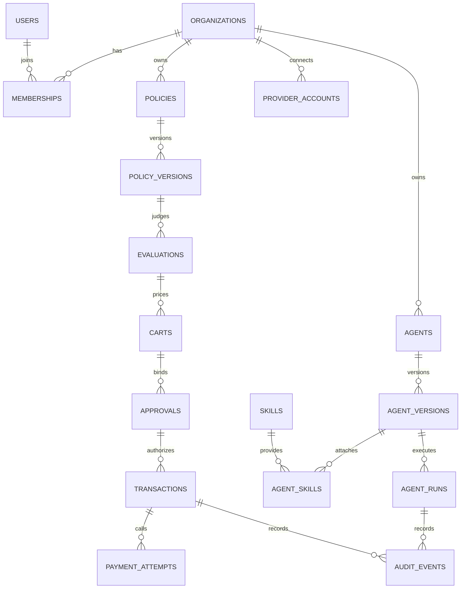

# Database design

Status: specification v0.1, 11 November 2026.
Parent: [ENGINE.md](ENGINE.md). Behavior: [ENGINE_DESIGN.md](ENGINE_DESIGN.md).

PostgreSQL 18 is the source of truth. One database. Domain tables are owned by Alembic. LangGraph checkpoint tables are owned by `AsyncPostgresSaver.setup()` and live in schema `checkpoints`. Alembic grants usage on that schema and does not rewrite those tables.

The DDL in this document is the target schema. Migrations are incremental. Ticket T03 creates the identity tables. Each later ticket adds the tables it writes. `policies.evaluations.proposal_id` references `commerce.carts` once both tables exist, and the cart row is inserted first.

No graph database. No object storage. Files that are actually configuration or event payloads go in `jsonb`. If a later release needs large blobs, it adds a storage interface then. That interface is not in v0.1.

## Rules

- Primary keys are `uuid`, generated with PostgreSQL 18 `uuidv7()` so inserts stay ordered.
- Every tenant table has `organization_id uuid not null` and a foreign key to `identity.organizations`.
- Money is `bigint` minor units plus `char(3)` currency. There is no `float` and no `numeric` money column.
- Currency exponents live in `commerce.currencies`. USD is inserted as exponent 2. Application code asks that table. It does not assume 100.
- Flexible documents (prompts' structured config, provider payloads, event payloads, approval snapshots) are `jsonb`.
- Published version tables reject updates to their content columns with a trigger. Status and bookkeeping columns that are allowed to change are listed in the trigger and nowhere else.
- Foreign keys are declared. Cascading delete is off for financial and audit tables.
- Queries from the application set `set_config('app.organization_id', ..., true)` for the transaction. Row level security policies require the column to match. The application role is not the table owner, and `FORCE ROW LEVEL SECURITY` is on. A query without the setting returns no rows.
- The migration role bypasses RLS and is not the role the API uses.
- Each release gets its own Alembic revision. Squashing waits until v1.0.

## Schema map



| Schema | Tables |
| --- | --- |
| `auth` | Better Auth's own tables, generated by that library at implementation and then committed as an Alembic revision. Mandate does not invent those columns |
| `identity` | `organizations`, `memberships`, `role_bindings`, `api_keys` |
| `agents` | `agents`, `agent_versions`, `agent_runs` |
| `models` | `model_providers`, `model_configs` |
| `skills` | `skills`, `skill_versions`, `agent_skills` |
| `policies` | `policies`, `policy_versions`, `evaluations` |
| `approvals` | `approvals`, `approval_events` |
| `commerce` | `currencies`, `carts`, `cart_items`, `transactions`, `payment_attempts`, `budget_reservations` |
| `integrations` | `provider_accounts`, `webhook_deliveries` |
| `events` | `outbox`, `audit_events` |
| `usage` | `token_usage` |
| `checkpoints` | Created by LangGraph. Not a Mandate schema design |

`auth.user.id` is the user id referenced by `identity.memberships.user_id`. There is one user record per person.

## identity

```sql
create table identity.organizations (
  id uuid primary key default uuidv7(),
  name text not null,
  created_at timestamptz not null default now()
);

create table identity.memberships (
  id uuid primary key default uuidv7(),
  organization_id uuid not null references identity.organizations(id),
  user_id text not null,
  created_at timestamptz not null default now(),
  unique (organization_id, user_id)
);

create table identity.role_bindings (
  membership_id uuid not null references identity.memberships(id),
  role text not null check (role in ('owner', 'admin', 'developer', 'finance_manager', 'approver', 'viewer')),
  primary key (membership_id, role)
);

create table identity.api_keys (
  id uuid primary key default uuidv7(),
  organization_id uuid not null references identity.organizations(id),
  name text not null,
  prefix text not null,
  secret_hash text not null,
  created_by text not null,
  revoked_at timestamptz,
  created_at timestamptz not null default now()
);
```

The API key secret is stored as a hash. The full secret is returned once at creation. `user_id` stays `text` because Better Auth's id type is fixed when its schema is generated. If that generation uses `uuid`, this column changes to `uuid` in the same revision. It does not stay a guess.

## agents and models

```sql
create table agents.agents (
  id uuid primary key default uuidv7(),
  organization_id uuid not null references identity.organizations(id),
  name text not null,
  description text not null default '',
  graph_kind text not null check (graph_kind in ('compiler', 'buyer')),
  created_at timestamptz not null default now()
);

create table agents.agent_versions (
  id uuid primary key default uuidv7(),
  organization_id uuid not null references identity.organizations(id),
  agent_id uuid not null references agents.agents(id),
  version integer not null check (version >= 1),
  provider text not null,
  model text not null,
  temperature double precision not null default 0,
  fallbacks jsonb not null default '[]',
  system_prompt text not null,
  published_at timestamptz not null default now(),
  published_by text not null,
  unique (agent_id, version)
);

create table agents.agent_runs (
  id uuid primary key default uuidv7(),
  organization_id uuid not null references identity.organizations(id),
  agent_version_id uuid not null references agents.agent_versions(id),
  policy_version_id uuid,
  status text not null check (status in ('queued', 'running', 'succeeded', 'failed', 'cancelled', 'limited')),
  cancel_requested boolean not null default false,
  input jsonb not null,
  output jsonb not null default '{}',
  stop_reason text not null default '',
  created_at timestamptz not null default now(),
  finished_at timestamptz
);
```

`agents.agent_versions` content columns are frozen by trigger: `provider`, `model`, `temperature`, `fallbacks`, `system_prompt`. Skill attachment is a row in `skills.agent_skills` inserted in the same transaction as the version, and those rows are frozen the same way.

```sql
create table models.model_providers (
  name text primary key,
  enabled boolean not null default false
);

create table models.model_configs (
  id uuid primary key default uuidv7(),
  organization_id uuid not null references identity.organizations(id),
  provider text not null references models.model_providers(name),
  model text not null,
  capabilities jsonb not null,
  created_at timestamptz not null default now(),
  unique (organization_id, provider, model)
);
```

Provider API keys are not columns on `model_configs`. They live in the process environment for v0.3, and in `integrations.provider_accounts` only once that table's encryption story exists. v0.3 does not invent a key-at-rest scheme in a hurry. The OpenAI key stays in the environment, which is what the prototype already does.

## skills

```sql
create table skills.skills (
  id uuid primary key default uuidv7(),
  organization_id uuid references identity.organizations(id),
  name text not null,
  unique (organization_id, name)
);

create table skills.skill_versions (
  id uuid primary key default uuidv7(),
  skill_id uuid not null references skills.skills(id),
  version integer not null check (version >= 1),
  description text not null,
  input_schema jsonb not null,
  output_schema jsonb not null,
  required_permissions jsonb not null default '[]',
  execution_mode text not null check (execution_mode = 'in_process'),
  timeout_ms integer not null,
  enabled boolean not null default true,
  unique (skill_id, version)
);

create table skills.agent_skills (
  agent_version_id uuid not null references agents.agent_versions(id),
  skill_version_id uuid not null references skills.skill_versions(id),
  primary key (agent_version_id, skill_version_id)
);
```

`organization_id` null marks a platform skill. Platform skill names `list_products` and `propose` are seeded by a migration. Their schemas reject additional properties.

## policies

```sql
create table policies.policies (
  id uuid primary key default uuidv7(),
  organization_id uuid not null references identity.organizations(id),
  name text not null,
  created_at timestamptz not null default now()
);

create table policies.policy_versions (
  id uuid primary key default uuidv7(),
  organization_id uuid not null references identity.organizations(id),
  policy_id uuid not null references policies.policies(id),
  version integer not null check (version >= 1),
  status text not null check (status in ('draft', 'active', 'retired')),
  currency char(3) not null,
  maximum_total_minor bigint not null check (maximum_total_minor > 0),
  constraints jsonb not null,
  original_instruction text not null,
  ambiguities jsonb not null default '[]',
  preferences jsonb not null default '[]',
  expires_at timestamptz not null,
  created_at timestamptz not null default now(),
  activated_at timestamptz,
  unique (policy_id, version)
);

create unique index one_active_policy_version
  on policies.policy_versions (organization_id, policy_id)
  where status = 'active';
```

`constraints` holds `allowed_brands`, `required_specs`, `forbidden_addon_types`, `max_executions`, `approval_required`, and `amount_includes`. The evaluator reads that document through the Pydantic model. A draft with a non-empty `ambiguities` array cannot transition to `active`. The trigger blocks updates to `constraints`, `currency`, `maximum_total_minor`, and `original_instruction`. `status` may move `draft -> active -> retired` only.

The prototype table `mandates` is this table. The name in the engine is policy version, because "mandate" is the product, not the row.

```sql
create table policies.evaluations (
  id uuid primary key default uuidv7(),
  organization_id uuid not null references identity.organizations(id),
  policy_version_id uuid not null references policies.policy_versions(id),
  proposal_id uuid not null,
  decision text not null check (decision in ('allow', 'deny', 'needs_approval')),
  reason_code text not null,
  cart_hash text,
  evaluated_amount_minor bigint,
  result jsonb not null,
  created_at timestamptz not null default now()
);
```

## approvals and commerce

```sql
create table commerce.currencies (
  code char(3) primary key,
  exponent smallint not null check (exponent >= 0 and exponent <= 4),
  enabled boolean not null default false
);

create table commerce.carts (
  id uuid primary key default uuidv7(),
  organization_id uuid not null references identity.organizations(id),
  policy_version_id uuid not null references policies.policy_versions(id),
  run_id uuid references agents.agent_runs(id),
  seller_id text not null,
  currency char(3) not null references commerce.currencies(code),
  total_minor bigint not null check (total_minor >= 0),
  cart_hash text not null,
  hash_version integer not null,
  catalog_sku text not null,
  created_at timestamptz not null default now()
);

create table commerce.cart_items (
  id uuid primary key default uuidv7(),
  cart_id uuid not null references commerce.carts(id),
  sku text not null,
  brand text not null,
  quantity integer not null check (quantity >= 1),
  unit_amount_minor bigint not null check (unit_amount_minor >= 0),
  addon_type text,
  ram_gb integer,
  storage_gb integer,
  storage_type text
);

create table approvals.approvals (
  id uuid primary key default uuidv7(),
  organization_id uuid not null references identity.organizations(id),
  proposal_id uuid not null references commerce.carts(id),
  policy_version_id uuid not null references policies.policy_versions(id),
  agent_version_id uuid references agents.agent_versions(id),
  approver_user_id text,
  cart_hash text not null,
  hash_version integer not null,
  amount_minor bigint not null,
  currency char(3) not null,
  merchant_id text not null,
  status text not null check (status in ('pending', 'valid', 'rejected', 'expired', 'revoked', 'consumed')),
  snapshot jsonb not null,
  signature text,
  expires_at timestamptz not null,
  created_at timestamptz not null default now()
);

create table commerce.transactions (
  id uuid primary key default uuidv7(),
  organization_id uuid not null references identity.organizations(id),
  proposal_id uuid not null references commerce.carts(id),
  approval_id uuid not null unique references approvals.approvals(id),
  policy_version_id uuid not null references policies.policy_versions(id),
  cart_hash text not null,
  amount_minor bigint not null check (amount_minor >= 0),
  currency char(3) not null,
  status text not null check (status in (
    'prepared', 'reserved', 'authorized', 'captured', 'voided', 'refunded', 'failed', 'unknown'
  )),
  provider text not null,
  provider_order_id text,
  provider_authorization_id text,
  provider_capture_id text,
  reason_code text not null default '',
  idempotency_key text not null,
  created_at timestamptz not null default now(),
  updated_at timestamptz not null default now(),
  unique (organization_id, idempotency_key)
);

create table commerce.budget_reservations (
  id uuid primary key default uuidv7(),
  organization_id uuid not null references identity.organizations(id),
  policy_version_id uuid not null references policies.policy_versions(id),
  transaction_id uuid not null unique references commerce.transactions(id),
  amount_minor bigint not null check (amount_minor >= 0),
  status text not null check (status in ('held', 'captured', 'released')),
  created_at timestamptz not null default now()
);

create table commerce.payment_attempts (
  id uuid primary key default uuidv7(),
  transaction_id uuid not null references commerce.transactions(id),
  operation text not null check (operation in ('create', 'authorize', 'capture', 'void', 'refund', 'retrieve')),
  request_id text not null,
  provider_status text,
  raw_response jsonb,
  created_at timestamptz not null default now(),
  unique (transaction_id, operation, request_id)
);
```

`commerce.payment_attempts.raw_response` stores the provider body with secrets redacted. It is evidence of what the provider returned. It is not editable by the agent.

Budget holding is a row in `budget_reservations` inserted in the same transaction that moves the payment to `reserved`, under `select ... for update` on the policy version row. The sum of `held` and `captured` reservations plus the new amount must fit under `maximum_total_minor`. That is the concurrency rule the prototype enforces with a thread lock.

## integrations, events, usage

```sql
create table integrations.provider_accounts (
  id uuid primary key default uuidv7(),
  organization_id uuid not null references identity.organizations(id),
  provider text not null,
  mode text not null check (mode in ('sandbox', 'live')),
  external_account_id text,
  created_at timestamptz not null default now(),
  unique (organization_id, provider, mode)
);

create table events.outbox (
  id uuid primary key default uuidv7(),
  organization_id uuid not null references identity.organizations(id),
  name text not null,
  aggregate_type text not null,
  aggregate_id uuid not null,
  payload jsonb not null,
  occurred_at timestamptz not null,
  published_at timestamptz
);

create table events.audit_events (
  id uuid primary key default uuidv7(),
  organization_id uuid not null references identity.organizations(id),
  name text not null,
  aggregate_type text not null,
  aggregate_id uuid not null,
  actor_type text not null,
  actor_id text not null,
  request_id text not null,
  reason_code text not null default '',
  payload jsonb not null,
  occurred_at timestamptz not null default now()
);

create table usage.token_usage (
  id uuid primary key default uuidv7(),
  organization_id uuid not null references identity.organizations(id),
  run_id uuid references agents.agent_runs(id),
  provider text not null,
  model text not null,
  input_tokens integer not null,
  output_tokens integer not null,
  occurred_at timestamptz not null default now()
);
```

Grants for the API role:

| Table | Grant |
| --- | --- |
| `events.audit_events` | `insert`, `select` |
| `events.outbox` | `insert`, `select`, `update` of `published_at` only, through a privileged worker function if column grants are too awkward; the worker is the only updater |
| Version content tables | `insert`, `select`. No `update` on content columns |
| Everything else tenant-owned | `select`, `insert`, `update` as the subsystem requires. No `delete` on approvals, transactions, evaluations, or audit |

`verify_history` reads `audit_events` ordered by `occurred_at`, `id`. v0.10 may add `prev_hash` and `row_hash`. Those columns are absent until the hash-chain design is specified on its own. Adding them later is an append-only alteration.

Webhook signing secrets and PayPal client secrets are environment variables through v0.8: `PAYPAL_CLIENT_ID`, `PAYPAL_CLIENT_SECRET`, `PAYPAL_WEBHOOK_ID`, `PAYPAL_ENV=sandbox`. They are not rows. `integrations.provider_accounts` records which organization is connected and in which mode. The secret store is a later design, and it stays out of the agent version and out of Redis.

## Row level security

```sql
alter table commerce.transactions enable row level security;
alter table commerce.transactions force row level security;

create policy tenant_isolation on commerce.transactions
  using (organization_id = current_setting('app.organization_id', true)::uuid)
  with check (organization_id = current_setting('app.organization_id', true)::uuid);
```

The same policy is applied to every table that has `organization_id`, except `events.audit_events` updates, which do not exist. Platform skills with a null organization are selected by a separate policy that allows `organization_id is null` for `select` only.

The setting is transaction-local. The API sets it at the start of every request from the resolved membership, not from the request body. Tests include a case with the setting unset and a case with another organization's id. Both must return zero rows for the victim's data.

## Indexes

Beyond primary keys and the unique constraints above:

- `agent_runs (organization_id, created_at desc)`
- `evaluations (organization_id, policy_version_id, created_at desc)`
- `approvals (organization_id, status, expires_at)`
- `transactions (organization_id, status)`
- `outbox (published_at, occurred_at)` where `published_at is null`
- `audit_events (organization_id, aggregate_type, aggregate_id, occurred_at)`

## Prototype mapping

The SQLite prototype is a behavior reference, not a data source to import.

| SQLite | PostgreSQL |
| --- | --- |
| `mandates` | `policies.policies` plus `policies.policy_versions` |
| `proposals` | `commerce.carts`, `commerce.cart_items`, `policies.evaluations` |
| `approvals` | `approvals.approvals` |
| `executions` | `commerce.transactions` plus `commerce.payment_attempts` |
| `audit_events` | `events.audit_events` |
| `skills`, `agents`, `agent_versions` | `skills.*`, `agents.*` |
| `price_overrides` | A catalog adapter input in tests. Not a production table |
| Execution status `succeeded` | Transaction status `captured` |
