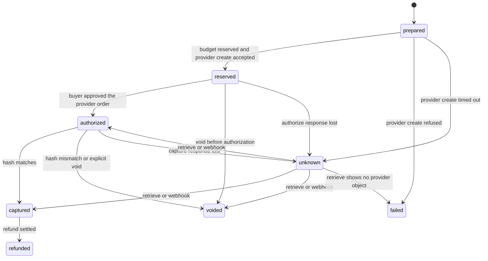

# Engine design

Status: specification v0.1, 11 November 2026.
Parent: [ENGINE.md](ENGINE.md). Persistence: [DATABASE_DESIGN.md](DATABASE_DESIGN.md). HTTP: [API_CONVENTIONS.md](API_CONVENTIONS.md).

The package name is `mandate-core`. The import root is `mandate_core`. Public types live in `mandate_core.contracts`. Subsystems depend on those types and on Protocols, not on each other's concrete classes.

Pydantic models below are the contract to implement. They use Pydantic 2. `extra="forbid"` is the default for every model that crosses a boundary. A model that accepts undeclared fields is a defect.

## Shared types

```python
from datetime import datetime
from typing import Literal
from uuid import UUID

from pydantic import BaseModel, ConfigDict, Field


class ContractModel(BaseModel):
    model_config = ConfigDict(extra="forbid")


class EngineError(ContractModel):
    """Raised at a subsystem boundary. The API maps it to the HTTP error body."""

    code: str
    message: str
    http_status: int = 400
    details: dict = Field(default_factory=dict)


class ExecutionLimits(ContractModel):
    max_steps: int = Field(ge=1, le=64, default=12)
    max_model_calls: int = Field(ge=1, le=64, default=12)
    max_input_tokens: int = Field(ge=1, default=100_000)
    max_output_tokens: int = Field(ge=1, default=8_000)
    deadline_ms: int = Field(ge=1_000, le=120_000, default=60_000)


class ExecutionContext(ContractModel):
    """Trusted context for one engine call.

    Built by the API or the runtime from the database and the authenticated
    principal. Passed into LangGraph as runtime context. A checkpoint does
    not store it. Resume rebuilds it.

    Model output, tool arguments, and catalog text cannot populate these fields.
    """

    model_config = ConfigDict(extra="forbid", frozen=True)

    organization_id: UUID
    user_id: UUID | None
    agent_id: UUID | None
    agent_version_id: UUID | None
    run_id: UUID | None
    policy_version_id: UUID | None
    permissions: tuple[str, ...]
    skill_allowlist: tuple[str, ...]
    request_id: str
    idempotency_key: str | None = None
    limits: ExecutionLimits = Field(default_factory=ExecutionLimits)
```

`permissions` contains canonical action strings from [SECURITY_MODEL.md](SECURITY_MODEL.md), already resolved for this principal and this organization. Subsystems call `authorize_action` again for any operation that moves money or publishes a version. The tuple on the context is a cache of that decision for the duration of one call, not a document the model can edit.

On resume, the runtime loads the run row, checks that the caller may still execute it, reloads the published version, and constructs a new `ExecutionContext`. If a membership or a skill binding was removed after the checkpoint, the rebuilt context sees the removal. Graph messages come back from the checkpoint. Authority does not.

## Domain models

Identifiers in the Python API are `UUID`. The database uses `uuid`. Human-readable prefixes (`agt_`, `pol_`) belong to the HTTP layer if a client needs them. The prototype's string ids are a client concern during the port, not the primary key type.

```python
class AgentDefinition(ContractModel):
    id: UUID
    organization_id: UUID
    name: str = Field(min_length=1, max_length=120)
    description: str = ""
    created_at: datetime


class ModelRef(ContractModel):
    provider: str
    model: str
    temperature: float = Field(ge=0, le=2, default=0)


class FallbackRef(ContractModel):
    """Used only when the primary call fails and required_capabilities is a subset."""

    model: ModelRef
    required_capabilities: tuple[str, ...]


class AgentVersion(ContractModel):
    """Immutable after insert. A change is a new version row."""

    id: UUID
    agent_id: UUID
    organization_id: UUID
    version: int = Field(ge=1)
    model: ModelRef
    fallbacks: tuple[FallbackRef, ...] = ()
    system_prompt: str
    skill_ids: tuple[UUID, ...]
    published_at: datetime
    published_by: UUID


class RunStatus(ContractModel):
    value: Literal[
        "queued",
        "running",
        "succeeded",
        "failed",
        "cancelled",
        "limited",
    ]


class AgentRun(ContractModel):
    id: UUID
    organization_id: UUID
    agent_version_id: UUID
    policy_version_id: UUID | None
    status: Literal["queued", "running", "succeeded", "failed", "cancelled", "limited"]
    input: dict
    output: dict
    stop_reason: str = ""
    created_at: datetime
    finished_at: datetime | None = None
```

`input` and `output` are JSON objects the run stored. They are not a channel back into `ExecutionContext`. The runner rejects an output that contains `organization_id`, `permissions`, `status` of a policy, or a provider credential key. Those keys are stripped and the run fails with `context_mutation`.

### Policy draft and decision

The compiler may return a draft. It may not return a status. The prototype's `CompilerDraft` is the first schema, generalized only by making the spec block extensible through a versioned `constraints` object. v0.6 still implements the laptop constraints exactly.

```python
class RequiredSpecs(ContractModel):
    ram_gb_min: int = Field(ge=1)
    storage_gb_min: int = Field(ge=1)
    storage_type: Literal["ssd"]


class PolicyDraft(ContractModel):
    currency: str = Field(min_length=3, max_length=3)
    maximum_total_minor: int = Field(gt=0)
    amount_includes: tuple[str, ...]
    allowed_brands: tuple[str, ...]
    required_specs: RequiredSpecs
    forbidden_addon_types: tuple[str, ...]
    max_executions: int = Field(ge=1)
    approval_required: bool
    preferences: tuple[str, ...]
    ambiguities: tuple[str, ...]
    original_instruction: str


class CartLine(ContractModel):
    sku: str
    brand: str
    quantity: int = Field(ge=1)
    unit_amount_minor: int = Field(ge=0)
    addon_type: str | None = None
    ram_gb: int | None = None
    storage_gb: int | None = None
    storage_type: str | None = None


class Seller(ContractModel):
    id: str


class Proposal(ContractModel):
    currency: str
    mandate_id: UUID
    mandate_version: int
    seller: Seller
    lines: tuple[CartLine, ...]
    total_minor: int = Field(ge=0)


class PolicyDecision(ContractModel):
    decision: Literal["allow", "deny", "needs_approval"]
    reason_codes: tuple[str, ...]
    policy_version_id: UUID
    policy_version: int
    cart_hash: str | None
    evaluated_amount_minor: int | None
    maximum_amount_minor: int | None
    currency: str | None
    explanations: tuple[dict, ...] = ()
```

Reason codes the evaluator must keep producing for the laptop policy:

| Code | When |
| --- | --- |
| `mandate_inactive` | The policy version is not active |
| `mandate_expired` | `now` is at or past `expires_at` |
| `stale_version` | The proposal names a different policy version |
| `currency` | Currency differs, or the currency is not enabled |
| `amount` | A quantity or unit amount is missing, boolean, or negative |
| `total_mismatch` | The line sum is not `total_minor` |
| `over_budget` | Total is above the maximum |
| `brand` | A line brand is outside `allowed_brands` |
| `addon` | A line's addon type is forbidden |
| `spec_ram` | A non-addon line is under the RAM minimum |
| `spec_storage` | Storage size or type fails |
| `needs_approval` | The cart fits and approval is required |
| `budget_exhausted` | Pending reservations plus this total exceed the maximum |
| `execution_limit` | The execution count is already at `max_executions` |
| `allow` | The cart fits and a matching approval already exists, or approval is not required |
| `approval_expired` | The approval row is past `expires_at` |
| `approval_replayed` | The approval is not in `valid` |
| `intent_mismatch` | The recomputed cart hash differs from the approved hash |
| `compiler_overreach` | The model set `status` or treated a vague phrase as a hard rule |
| `compiler_invalid` | The draft failed schema validation |

The first matching deny in the order used by `gateway/decide.py` remains the order for v0.6. Explanations may list later rules. They do not change `reason_codes[0]`.

Amounts in examples and in the database are minor units. 80000 is $800.00 for a currency with exponent 2. The money module takes the exponent from the currency registry. USD is exponent 2 and is the only enabled currency through v0.8.

### Canonical cart hash

Hash version 1 is the prototype algorithm, so existing digests stay valid.

```python
HASH_VERSION = 1

def canonical_body(proposal: Proposal) -> dict:
    lines = []
    for line in proposal.lines:
        lines.append(
            {
                "addon_type": line.addon_type,
                "brand": line.brand,
                "quantity": line.quantity,
                "ram_gb": line.ram_gb,
                "sku": line.sku,
                "storage_gb": line.storage_gb,
                "storage_type": line.storage_type,
                "unit_amount_minor": line.unit_amount_minor,
            }
        )
    lines.sort(key=lambda item: (item["sku"], "" if item["addon_type"] is None else item["addon_type"]))
    return {
        "currency": proposal.currency,
        "hash_version": HASH_VERSION,
        "lines": lines,
        "mandate_id": str(proposal.mandate_id),
        "mandate_version": proposal.mandate_version,
        "seller_id": proposal.seller.id,
    }
```

The digest is SHA-256 over `json.dumps(body, sort_keys=True, separators=(",", ":"))`, encoded UTF-8, returned as lowercase hex. A later hash version is a new function selected by `hash_version` stored on the approval. Old approvals keep version 1.

The catalog supplies `unit_amount_minor`. A tool argument named `suggested_unit_amount_minor` is ignored for the hash and for the decision. The prototype test that covers the ignored $50 suggestion stays in the porting gate.

### Approval snapshot

```python
class ApprovalSnapshot(ContractModel):
    model_config = ConfigDict(extra="forbid", frozen=True)

    organization_id: UUID
    approver_user_id: UUID
    agent_version_id: UUID | None
    policy_version_id: UUID
    policy_version: int
    proposal_id: UUID
    cart_hash: str
    hash_version: int
    amount_minor: int
    currency: str
    merchant_id: str
    expires_at: datetime
```

The database row is the authority. From v0.7 the API also returns a server-signed token over the canonical snapshot bytes, using a key that stays on the server. Verification loads the row and checks the signature. A valid signature with a missing or revoked row is a denial. The token cannot outlive the row.

### Commerce

```python
TransactionStatus = Literal[
    "prepared",
    "reserved",
    "authorized",
    "captured",
    "voided",
    "refunded",
    "failed",
    "unknown",
]


class Transaction(ContractModel):
    id: UUID
    organization_id: UUID
    proposal_id: UUID
    approval_id: UUID
    cart_hash: str
    amount_minor: int
    currency: str
    status: TransactionStatus
    provider: str
    provider_order_id: str | None = None
    provider_authorization_id: str | None = None
    provider_capture_id: str | None = None
    reason_code: str = ""
    idempotency_key: str
```

The prototype's `succeeded` maps to `captured` in the engine.



`unknown` is a holding state. The recovery path is retrieve or a verified webhook. It is never "create a second charge."

## Subsystem interfaces

Each interface is a `typing.Protocol`. Methods are async. Implementations live in the subsystem package. Tests use fakes that implement the same Protocol.

### Identity

```python
class Identity(Protocol):
    async def authenticate(self, credential: Credential) -> Principal: ...
    async def resolve_context(self, principal: Principal, organization_id: UUID) -> ExecutionContext: ...
    async def authorize_action(self, context: ExecutionContext, action: str, subject: str, resource: ResourceRef | None) -> None: ...
```

`authenticate` accepts a session assertion from the web process or an API key. It returns a principal or raises `unauthenticated`. `resolve_context` checks membership and fills `organization_id` from the membership, ignoring any organization id in a model payload. `authorize_action` raises `forbidden` when the catalog denies the action. Cross-organization resource ids raise `not_found`, so existence does not leak.

The web process establishes the browser session. The API process is the component that the engine trusts. See [SECURITY_MODEL.md](SECURITY_MODEL.md).

### Model orchestration

```python
class ModelCapabilities(ContractModel):
    tool_calling: bool
    structured_output: bool
    streaming: bool
    context_window: int
    input_types: tuple[str, ...]
    reasoning_modes: tuple[str, ...]


class ModelProvider(Protocol):
    name: str

    async def invoke(self, request: ModelRequest) -> ModelResponse: ...
    async def stream(self, request: ModelRequest) -> AsyncIterator[ModelEvent]: ...
    def capabilities(self, model: str) -> ModelCapabilities: ...


class ModelOrchestrator(Protocol):
    async def invoke_model(self, context: ExecutionContext, request: ModelRequest) -> ModelResponse: ...
    async def stream_model(self, context: ExecutionContext, request: ModelRequest) -> AsyncIterator[ModelEvent]: ...
    async def get_model_config(self, context: ExecutionContext, config_id: UUID) -> ModelRef: ...
```

The orchestrator validates the request, calls the provider named on the agent version, normalizes errors, and writes a usage row (input tokens, output tokens, provider, model, run id). A provider error uses the version's `fallbacks` only when every capability in `required_capabilities` is true for the replacement. Otherwise the run fails with `model_unavailable`. The orchestrator records which model actually ran.

v0.3 ships an OpenAI adapter and a deterministic `StaticProvider` used in tests. Both register behind `ModelProvider`. The business call site in the runtime names neither class. Anthropic is the same interface, added when a key and a test double exist. It is not required to finish v0.3.

Structured output is validated by Pydantic after the call. A schema failure is `model_output_invalid`. The runtime does not retry by relaxing the schema.

### Agent runtime

```python
class AgentRuntime(Protocol):
    async def create_run(self, context: ExecutionContext, agent_id: UUID, version_id: UUID | None, run_input: dict) -> AgentRun: ...
    async def resume_run(self, context: ExecutionContext, run_id: UUID, resume_input: dict | None) -> AgentRun: ...
    async def cancel_run(self, context: ExecutionContext, run_id: UUID) -> AgentRun: ...
    async def get_run(self, context: ExecutionContext, run_id: UUID) -> AgentRun: ...
```

`create_run` resolves the version through the publisher's resolver. A missing `version_id` means the latest published version, which is a stable pointer to one immutable row, not "whatever is in a text box." A draft prompt cannot be executed.

| Capability | Behavior |
| --- | --- |
| Run creation | One new `agent_runs` row and one LangGraph thread id equal to the run id |
| Version resolution | Load the published row. Refuse to run an unpublished edit |
| Checkpointing | `AsyncPostgresSaver` from `langgraph-checkpoint-postgres`. The runtime calls `setup()` once per environment. Alembic does not own those tables |
| Resume | Load the checkpoint, rebuild `ExecutionContext`, continue |
| Cancellation | Set `cancel_requested`. The runner stops at the next super-step boundary. Completed skill writes stay written. Open payments stay open |
| Limits | Before each model call, enforce `ExecutionLimits`. On breach, status becomes `limited` |
| Streaming | Publish progress on Redis for subscribers. Persist the trace in PostgreSQL regardless |
| Tracing | Each model call and skill call appends an event |
| Replay | `get_run` plus the event timeline reconstruct the run. v0.4 has no operation that re-executes tools |

LangGraph's checkpointer is the graph-state store. Mandate does not invent a second copy of channel values. Domain facts (proposals, decisions, transactions) are Mandate rows written by repositories. A checkpoint without those rows is an incomplete run, and the trace says so.

### LangGraph state

LangGraph 1.2 separates checkpointed state from run-scoped context. `config_schema` is deprecated. Graphs are built with `context_schema`.

State is what nodes return and what the checkpointer saves. Context is frozen for the invocation, is not saved in the checkpoint, and is supplied again on resume.

```python
from dataclasses import dataclass
from operator import add
from typing import Annotated

from typing_extensions import TypedDict


# SkillExecutor is the SkillRuntime Protocol. Nodes call it. They do not import PayPal.
@dataclass(frozen=True)
class GraphContext:
    """Projection of ExecutionContext safe to hold beside the graph.

    Identifiers and an in-process skill port. No provider secret, no raw API key,
    no database URL. The skill port is not serialized.
    """

    organization_id: UUID
    run_id: UUID
    agent_version_id: UUID
    policy_version_id: UUID | None
    request_id: str
    skill_allowlist: frozenset[str]
    skills: SkillExecutor


class TraceEvent(TypedDict):
    agent: str
    text: str


class BuyerState(TypedDict, total=False):
    messages: Annotated[list, add_messages]
    proposal_ids: Annotated[list[str], add]
    trace: Annotated[list[TraceEvent], add]
    stop_reason: str


class CompilerState(TypedDict, total=False):
    instruction: str
    draft: dict
    ambiguities: list[str]
    trace: Annotated[list[TraceEvent], add]
```

Nodes read authority from `runtime.context`, the LangGraph `Runtime[GraphContext]` argument. They do not read `organization_id` from `BuyerState`. The compiler node validates model JSON with `PolicyDraft` and rejects a payload that contains `status`, raising `compiler_overreach`. Activation is `activate_policy` on the policy subsystem, called by the API on behalf of a user who has that action.

The buyer graph's tools are the skills on the published version. The tool list passed to the model is built from that version. `propose` accepts a SKU. The schema forbids a price, an approval id, and a PayPal order id. PayPal is absent from the tool list.

Two graphs ship in v0.4:

| Graph | Nodes | Tools |
| --- | --- | --- |
| Compiler | One compiler node, then end | None. The model returns JSON |
| Buyer | Model node and tool node, looping until the model stops or limits hit | `list_products`, `propose` |

`graph_factory` selects the graph from the agent definition's `graph_kind` (`compiler` or `buyer`). Adding a graph is a new module registered in the factory. It is not a change to the policy or commerce packages.

Checkpoint configuration:

```python
config = {"configurable": {"thread_id": str(run_id)}}
await graph.ainvoke(initial_state, config=config, context=graph_context)
```

`thread_id` is the run id. Time travel in v0.4 means reading a prior checkpoint for inspection. It does not mean invoking the graph again with tool side effects.

### Skill runtime

```python
class SkillDefinition(ContractModel):
    id: UUID
    organization_id: UUID | None  # None is a platform skill shipped with the engine
    name: str
    description: str
    version: int
    input_schema: dict
    output_schema: dict
    required_permissions: tuple[str, ...]
    execution_mode: Literal["in_process"]
    timeout_ms: int = Field(ge=100, le=30_000)
    enabled: bool


class SkillRuntime(Protocol):
    async def register_skill(self, context: ExecutionContext, definition: SkillDefinition) -> SkillDefinition: ...
    async def validate_call(self, context: ExecutionContext, skill_id: UUID, arguments: dict) -> None: ...
    async def execute_skill(self, context: ExecutionContext, skill_id: UUID, arguments: dict) -> dict: ...
```

Registration and execution are different methods and different permissions (`create Skill` versus the agent's allowlist). `validate_call` checks four things, in order: the skill is enabled, the skill id is on the published version, the skill name is in `context.skill_allowlist`, and the arguments match `input_schema`. Any failure is `skill_not_attached` or `skill_invalid` and is returned to the model as a tool error. The model does not get a second path that skips validation.

`execution_mode` has one legal value in v0.5: `in_process`, and only for skills that ship in this repository. HTTP skills, MCP tools, and uploaded code are later execution modes. They require an isolated runner that does not exist in v0.5. The enum gains values then. It does not silently accept them now.

Platform skills for the laptop workflow:

| Name | Effect |
| --- | --- |
| `list_products` | Read the catalog adapter. Listing text is untrusted. Price, brand, and specs are catalog fields |
| `get_product` | One SKU |
| `compare_products` | A pure comparison of catalog fields the caller names |
| `propose` | Build a cart from the catalog, call `evaluate`, store the proposal. No price argument |
| `check_inventory` | Catalog availability |
| `calculate_total` | Sum catalog minor units, tax, and delivery using the money module |
| `create_purchase_request` | Persist a proposal that `evaluate` has already judged. Still no provider call |

v0.4's mock skill and v0.5's first real skills are `list_products` and `propose`. The others are the registry's next entries, each with a schema and a test, and they stay out of the payment path.

Timeouts and retries apply to skill I/O. A retry of `propose` for the same run and SKU returns the stored proposal. It does not insert a second one.

### Policy

```python
class PolicyEngine(Protocol):
    async def evaluate(self, context: ExecutionContext, policy_version_id: UUID, proposal: Proposal, now: datetime) -> PolicyDecision: ...
    async def explain(self, context: ExecutionContext, evaluation_id: UUID) -> PolicyDecision: ...
    async def activate_policy(self, context: ExecutionContext, policy_version_id: UUID) -> PolicyVersion: ...
```

`evaluate` loads the version, checks it is immutable content, and calls the pure evaluator. The evaluator does not open a database connection. `activate_policy` refuses a draft that has ambiguities, refuses model-supplied status, and is the only writer that sets `status = active`. One organization has one active version of a given policy. Activating version N leaves N-1 stored and not active.

`explain` returns the stored decision, including which rules passed. It does not re-decide under a newer policy unless the caller explicitly calls `evaluate` with that version id. That second call is the hook for policy simulation in a later release: same historical proposals, a draft version, no activation.

The compiler graph may propose a `PolicyDraft`. The policy package validates it. Natural-language compilation is a client of the model orchestrator, not a second HTTP client hidden in the policy package.

### Approval

```python
class ApprovalEngine(Protocol):
    async def request_approval(self, context: ExecutionContext, proposal_id: UUID) -> Approval: ...
    async def approve(self, context: ExecutionContext, approval_id: UUID) -> Approval: ...
    async def reject(self, context: ExecutionContext, approval_id: UUID, reason: str) -> Approval: ...
    async def expire(self, context: ExecutionContext, now: datetime) -> int: ...
```

`request_approval` requires a stored decision of `needs_approval` and a cart hash. `approve` binds the snapshot fields in the model above to the authenticated user. A second approve of a snapshot whose hash no longer matches the stored proposal returns `intent_mismatch` and does not flip the row to `valid`. `reject` and `expire` move the row out of `valid`. Expiry is also enforced at read time, so a stopped worker cannot leave a stale approval usable.

Revocation is `reject` on a still-valid approval, or a dedicated `revoked` status written by the same method once the row has been used. A used approval cannot authorize a second transaction. Status values: `pending`, `valid`, `rejected`, `expired`, `revoked`, `consumed`.

Multi-step approval chains are a later release. The snapshot model does not assume a single approver forever: `approver_user_id` is the person who moved this row to `valid`. A chain can be additional rows pointing at the same snapshot. v0.7 implements one row.

### Commerce

```python
class PaymentProvider(Protocol):
    name: str

    def capabilities(self) -> ProviderCapabilities: ...
    async def create_order(self, command: CreateOrder) -> ProviderOrder: ...
    async def authorize(self, command: AuthorizeOrder) -> ProviderAuthorization: ...
    async def capture(self, command: CaptureOrder) -> ProviderCapture: ...
    async def void(self, command: VoidOrder) -> ProviderVoid: ...
    async def refund(self, command: RefundOrder) -> ProviderRefund: ...
    async def verify_webhook(self, headers: dict, body: bytes) -> ProviderEvent: ...


class CommerceEngine(Protocol):
    async def prepare(self, context: ExecutionContext, proposal_id: UUID, approval_id: UUID) -> Transaction: ...
    async def authorize(self, context: ExecutionContext, transaction_id: UUID, provider_order_id: str) -> Transaction: ...
    async def capture(self, context: ExecutionContext, transaction_id: UUID) -> Transaction: ...
    async def void(self, context: ExecutionContext, transaction_id: UUID) -> Transaction: ...
    async def refund(self, context: ExecutionContext, transaction_id: UUID, amount_minor: int) -> Transaction: ...
```

`prepare` reloads the proposal from the catalog prices, recomputes the hash, checks the approval snapshot, reserves the budget under a row lock, and calls `create_order` on the adapter named by the organization's provider account. The PayPal request id is the transaction id, which is what the prototype does with the execution id.

`capture` runs `execution_guard` and `capture_action` from the prototype: hash match captures, hash mismatch voids, and the reason code is `intent_mismatch`. The provider's willingness to capture a nearby amount is irrelevant.

`ProviderCapabilities` records whether the provider supports separate authorization and capture. PayPal Orders v2 with `intent: AUTHORIZE` does. A later adapter that only supports immediate capture must declare that. Commerce then refuses a policy that needs a delayed capture on that provider, with `provider_capability`. It does not emulate the delay by capturing early.

Webhook handling verifies the signature, deduplicates on the provider event id, and resolves `unknown` or advances a matching transition. An unverified body does not change a row.

The build order inside v0.8 is fixed: provider-independent transaction model, provider interface, PayPal sandbox adapter, create, authorize, capture, void, refund, webhooks, then reconciliation and idempotency tests. Refunds against sandbox can land at the end of the release. They do not jump ahead of void-on-mismatch.

### Event and audit

```python
class EventEnvelope(ContractModel):
    id: UUID
    organization_id: UUID
    name: str
    aggregate_type: str
    aggregate_id: UUID
    actor_type: Literal["user", "agent", "system", "provider"]
    actor_id: str
    request_id: str
    payload: dict
    occurred_at: datetime


class EventLog(Protocol):
    async def append_event(self, context: ExecutionContext, event: EventEnvelope, connection) -> None: ...
    async def get_timeline(self, context: ExecutionContext, aggregate_type: str, aggregate_id: UUID) -> list[EventEnvelope]: ...
    async def verify_history(self, context: ExecutionContext, aggregate_id: UUID) -> HistoryReport: ...
```

`append_event` participates in the caller's database transaction. The outbox row commits with the state change or not at all. The worker publishes after commit. v0.1's "publish" can be a no-op consumer that marks the row delivered, so the spine exists before any external subscriber.

`verify_history` in v0.1 checks that the timeline is complete and ordered for the aggregate. Hash chaining is a v0.10 addition. Until that ships, the history is an append-only table protected by database grants. The product must not describe it as cryptographically immutable.

Event names:

```
agent.created
agent.version.published
agent.run.started
agent.run.completed
agent.run.cancelled
agent.run.limited

skill.registered
skill.executed

policy.created
policy.activated
policy.evaluated

approval.requested
approval.granted
approval.rejected
approval.expired
approval.revoked

commerce.order.created
commerce.payment.authorized
commerce.payment.captured
commerce.payment.voided
commerce.payment.refunded
commerce.payment.unknown

model.invoked
```

Operational events and audit events share this envelope. Audit events are the subset written to `events.audit_events`, which the application role can insert and select, and cannot update or delete. Payment, approval, policy activation, and version publication are audit events. A model token-usage row is operational usage, not an audit event.

## What a node is allowed to return

A graph node returns a partial state update: messages, proposal ids, trace lines, a validated draft, a stop reason.

A graph node does not return a policy status, an approval status, a transaction status, a secret, or a replacement `ExecutionContext`. The runner's state reducer rejects those keys with `context_mutation` and fails the run.

## Tests that define "done" for the engine package

Each subsystem's tests import `mandate_core` and do not import FastAPI.

| Release | Test that must pass |
| --- | --- |
| v0.2 | Subsystems can pass `ExecutionContext`, `Proposal`, and `PolicyDecision` without a web type in sight |
| v0.3 | One caller runs against `StaticProvider` and against the OpenAI adapter by changing the provider name |
| v0.4 | A published version runs a multi-step buyer graph, calls a fake skill, checkpoints, resumes, and returns a trace |
| v0.5 | A skill that is not on the version is rejected. A registered skill executes and validates schemas |
| v0.6 | The laptop fixtures from `tests/test_decide.py` pass against the pure evaluator, including repeated calls returning the same decision |
| v0.7 | Approving proposal A and then changing a line makes the approval unusable |
| v0.8 | Sandbox or fake-provider purchase can be created, authorized, revalidated, captured, and voided. Two reservations cannot spend the same last minor unit. The same idempotency key returns the same transaction |
| v0.9 | One laptop workflow's timeline names every event from `agent.run.started` through `commerce.payment.captured` or `commerce.payment.voided` |
