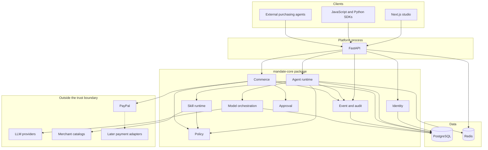
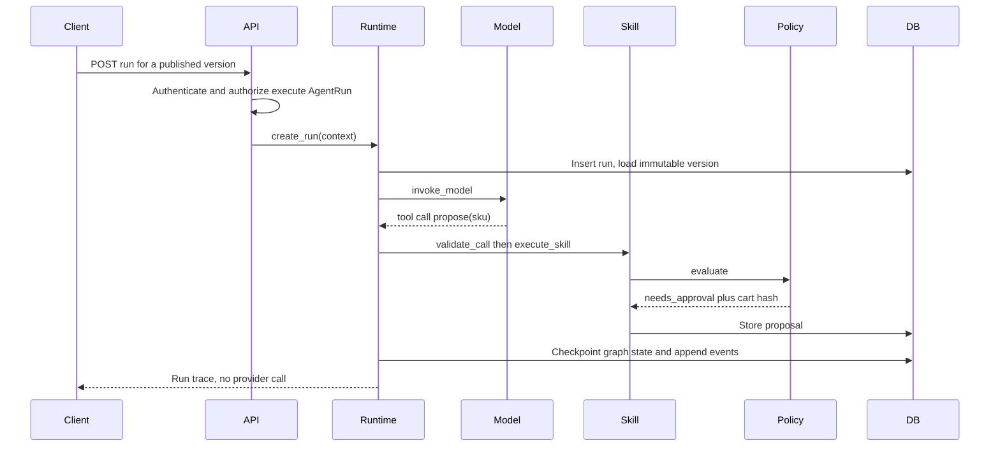
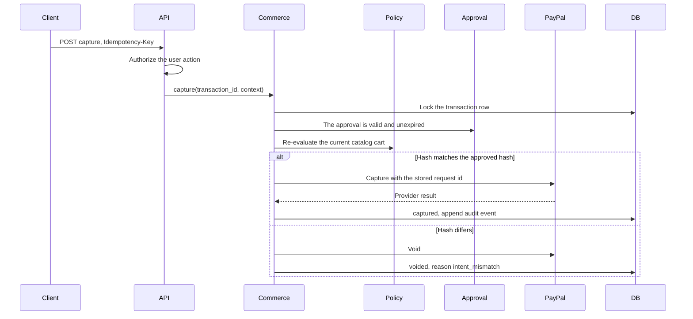

# System architecture

Status: specification v0.1, 11 November 2026.
Parent: [ENGINE.md](ENGINE.md). Interfaces: [ENGINE_DESIGN.md](ENGINE_DESIGN.md). Data: [DATABASE_DESIGN.md](DATABASE_DESIGN.md).

## Shape

v0.1 through v1.0 are a modular monolith.

| Process | Role | When it exists |
| --- | --- | --- |
| `mandate-api` | FastAPI. Authenticates the caller, builds an execution context, and calls the engine | v0.1 |
| `mandate-worker` | Same package, different entrypoint. Delivers the outbox, expires approvals, handles verified webhooks | v0.8 |
| `web` | Next.js. Renders the studio and calls the API | A thin shell in v0.1. The studio surface in v0.9 |
| PostgreSQL 18 | Source of truth for domain rows, audit, outbox, and LangGraph checkpoints | v0.1 |
| Redis 8 | Cache, rate limits, and live run progress | v0.1 for connectivity. Used for progress streaming in v0.4 |

PostgreSQL remains correct if Redis is down. Financial locks and the outbox use PostgreSQL (`FOR UPDATE`, `SKIP LOCKED`). Redis is a cache and a progress channel. A missed progress message is allowed. A missed payment transition is not.

There is no object-storage service and no container runtime in this design. Production is three managed processes (web, API, worker) plus managed PostgreSQL and Redis. The worker is still the same Python package.

Split a subsystem into its own service only when one of these is true: it needs independent scaling that the monolith cannot give, it needs a harder security boundary than a separate database role, or an operational team has to deploy it on a different cadence. None of those is true at the start.

## Containers



The PayPal adapter sits inside the commerce subsystem, behind a provider interface. FastAPI does not import the PayPal client. A skill does not import it either.

## Dependency direction

Imports point inward.

| From | May import | Must not import |
| --- | --- | --- |
| `apps/web` | The HTTP API | `mandate_core`, provider secrets, the database |
| `services/api` | `mandate_core` public interfaces | Provider client classes, LangGraph graph builders |
| `mandate_core.runtime` | Model, skill, policy, event, and identity interfaces | Commerce capture, the PayPal client, FastAPI |
| `mandate_core.policy` | Its own models | LangGraph, FastAPI, PayPal, SQLAlchemy sessions inside the evaluator |
| `mandate_core.approval` | Policy decision types, event interface | PayPal, LangGraph |
| `mandate_core.commerce` | Policy, approval, event, and identity interfaces | LangGraph, FastAPI, agent prompts |
| `mandate_core.skills` | The skill registry and a policy port for proposal skills | Provider secrets |
| Provider adapters | The commerce provider interface | Policy rules, prompts, CASL |

The policy evaluator is a pure function of `(policy_version, proposal, evaluation_context)`. Persistence lives in repositories, outside the evaluator. That is what makes the same input return the same decision, and what makes policy simulation possible later: run the pure function against stored proposals without activating the version.

## The two execution paths

### Agent path

The runtime loads a published agent version, builds the graph, and lets the model call skills that are both attached to that version and present on the execution context. A purchase skill writes a proposal and asks the policy engine for a decision. The skill returns the decision. It does not contact a payment provider.



### Financial path

A trusted API handler calls commerce. Commerce loads the stored cart, recomputes the hash, rechecks the approval and the policy, and only then calls the adapter. The amount, currency, and idempotency key sent to the provider come from the transaction row.



Cancelling a graph run does not void a payment. Void and refund are commerce operations with their own authorization and their own idempotency keys. A graph can finish or fail while an authorization is still open. The transaction row is the lifecycle that continues.

## Trust boundary

Inside the boundary: policy rows, approval rows, transaction rows, provider secrets, webhook signing secrets, the decision function, and the database roles.

Outside the boundary: the model, agent prompts, tool arguments, catalog text, the browser, and any external agent. They cross inward only through the API, after authentication. The API establishes who is calling. The approval record establishes who approved a cart. Those are different facts.

The gateway sends the frozen amount, currency, and idempotency key to a provider. It does not send a chain of thought. It does not accept a provider URL or a provider credential from tool arguments.

## Repository tree

The prototype stays where it is until the porting gate passes.

```
gateway/                  reference prototype, SQLite, still runnable
web/                      reference console, Next.js 15
tests/                    prototype decision and flow tests
docs/                     this specification and the HTML handbook
```

The target tree is created by ticket T01. It does not replace `gateway/` on the day it appears.

```
apps/
  web/                    Next.js studio. Client of the API
services/
  api/                    FastAPI process. Depends on mandate-core
  worker/                 Worker entrypoint. Same dependency, from v0.8
packages/
  mandate-core/           the engine
    pyproject.toml
    src/mandate_core/
      contracts/          Protocols and Pydantic models. The stable surface
      identity/
      runtime/
      models/             model orchestration. The name is the subsystem, not ORM models
      skills/
      policy/
      approval/
      commerce/
        providers/
          paypal/
      events/
      persistence/        SQLAlchemy repositories. Not imported by the policy evaluator
      db/                 Alembic migrations
    tests/
  sdk-python/             from v0.9
  sdk-js/                 from v0.9
contracts/
  permissions.json        the action and subject catalog both CASL and Python load
docs/
```

`mandate-core` version and the HTTP API version are allowed to diverge after v1.0. Until then they move together. The HTTP surface stays `/v1` for the resources in [API_CONVENTIONS.md](API_CONVENTIONS.md).

### Engine package layout

The runtime layout from the draft plan lives under `mandate_core.runtime`. Names are the public modules. Internal files can change without a version bump. The Protocol modules cannot.

```
mandate_core/runtime/
  engine.py               create_run, resume_run, cancel_run, get_run
  runner.py
  compiler.py             builds a graph from a published version
  registry.py
  graphs/
    buyer_graph.py
    compiler_graph.py
    graph_factory.py
  state/
    schemas.py
    checkpoint.py
  execution/
    limits.py
    lifecycle.py
  versioning/
    publisher.py
    resolver.py
    snapshots.py
```

Policy, skills, and commerce follow the same pattern: a small public module, a pure core, repositories behind interfaces, and tests that do not boot FastAPI.

## How the current prototype maps

| Prototype | Engine home |
| --- | --- |
| `gateway/decide.py` | `mandate_core.policy` |
| `gateway/hashing.py` | `mandate_core.commerce` canonical cart |
| `gateway/compiler.py` | Compiler graph plus policy draft validation |
| `gateway/agents.py` | `mandate_core.runtime` graphs |
| `gateway/llm.py` | `mandate_core.models` OpenAI adapter |
| `gateway/studio.py` | Agent, version, and skill repositories |
| `gateway/paypal.py` | `mandate_core.commerce.providers.paypal` |
| `gateway/store.py` | PostgreSQL repositories |
| `gateway/main.py` | `services/api` |
| `web/` | `apps/web`, after the API exists |

The prototype's SQLite file is not migrated row by row. The behavior is migrated by tests.

## Local processes

Development runs on the host. Windows is a first-class development OS for this repository.

```bash
# API, from services/api
uv run fastapi dev

# Migrations, from packages/mandate-core
uv run alembic upgrade head

# Studio, from apps/web
pnpm dev
```

PostgreSQL and Redis are installed locally or used as managed instances. The API reads its connection strings from the environment. Provider secrets and model keys are read there too. They are never written into a published agent version.

## Scaling rules that are deliberately postponed

- No second database.
- No graph database. Agent-to-skill links are relational rows.
- No separate vector database. If retrieval is needed, pgvector in this PostgreSQL is the first place it goes, and it is unused in the first 30 days.
- No user-supplied Python executed inside the API process. Skills start as code in this repository.
- No silent model fallback. A fallback is a list on the agent version, and it runs only when the replacement model declares the capabilities the call needs.
